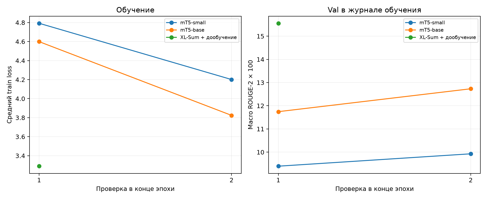
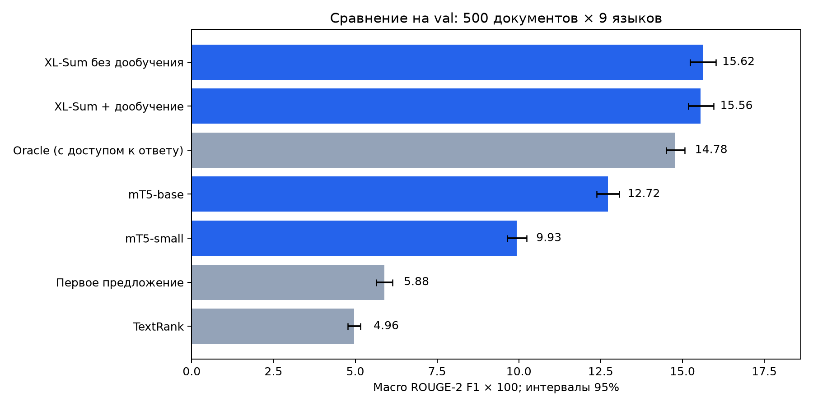
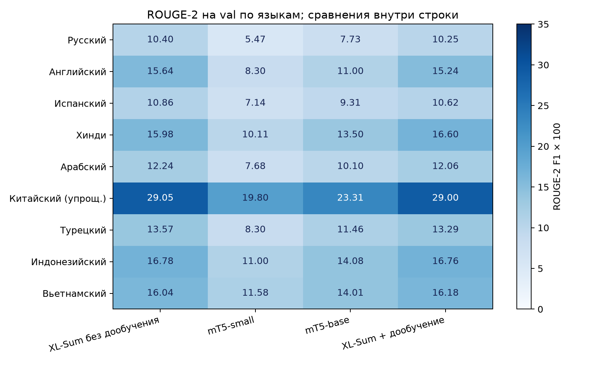

# Многоязычная суммаризация новостей на XL-Sum

Короткое резюме помогает понять, о чём новость, не читая статью целиком. При этом простого
сокращения текста недостаточно: нужно выделить главное событие и сохранить факты. Для многоязычной
модели задача усложняется различиями в грамматике, письменности и объёме доступных данных.
В этой работе исследуется, насколько хорошо одна модель справляется с суммаризацией на девяти
языках и можно ли улучшить готовое решение дополнительным обучением.

### Коротко о результатах

В работе обучены три модели: mT5-small и mT5-base, дообученные из `google/mt5-*` на 20 000 статей
каждого из девяти языков, и модель авторов XL-Sum, дополнительно обученная на тех же данных.
Для сравнения использованы простые методы без обучения и опубликованная модель авторов XL-Sum.
Модель авторов в этой работе не обучалась: она служит **планкой качества** и проверкой расчёта
метрик. Совпадение её оценки с таблицей авторов (раздел 6) подтверждает, что числа остальных
моделей посчитаны корректно.

| Что сравнивается | ROUGE-2 на val |
|---|---|
| Простые методы: первое предложение / TextRank | 5,88 / 4,96 |
| **Наша mT5-small** | **9,93** |
| **Наша mT5-base** | **12,72** |
| Планка: модель авторов XL-Sum | 15,62 |
| **Наша модель XL-Sum + дообучение** | **15,56** |

- Обученные модели превосходят простые методы: mT5-base — более чем в два раза.
- Размер модели важен: base лучше small на 2,79 пункта при тех же данных.
- mT5-base отстаёт от модели авторов на 2,89 пункта, хотя авторы обучали её на 45 языках
  и в несколько раз большем объёме данных.
- Дообученная модель XL-Sum вышла **вровень** с исходной: разница −0,06 пункта лежит в пределах
  статистической погрешности, а по ROUGE-1 и ROUGE-L она немного выше.

## 1. Вариант / задача

Цель работы состоит в разработке и сравнении моделей, которые по тексту новостной статьи создают
короткое резюме **на языке оригинала**. В основе решения лежит абстрактивная суммаризация.
Она позволяет передать содержание своими словами и объединить сведения из разных предложений.
От модели требуется сохранить главное событие, имена участников, числа и причинные связи.

Исследуются русский, английский, испанский, хинди, арабский, китайский с упрощённой письменностью,
турецкий, индонезийский и вьетнамский языки. Такой набор позволяет проверить одну модель
на нескольких языковых семьях и пяти системах письма.

Работа включает подготовку корпуса, обучение моделей разного размера и сравнение с простыми
способами выделения предложений. Отдельный эксперимент посвящён готовой модели XL-Sum:
проверяется, поможет ли ей дополнительное обучение только на выбранных девяти языках.
Ожидается, что увеличение размера mT5 улучшит качество, а специализация XL-Sum позволит
точнее передавать содержание новостей.

### Данные и разбиение

Для экспериментов выбран корпус XL-Sum v2.0. Он состоит из статей BBC и кратких резюме,
написанных редакцией. Такое происхождение данных соответствует задаче: модель учится выделять
новостной повод по редакционному образцу. Первоначальная публикация охватывала 44 языка,
а обновлённый корпус содержит 45. Данные доступны в [репозитории авторов](https://github.com/csebuetnlp/xl-sum)
по лицензии CC BY-NC-SA 4.0.

<!-- results:data:start -->

| Язык | Train после очистки | Val (полный) | Test (полный) |
| --- | --- | --- | --- |
| Русский | 61494 | 7780 | 7780 |
| Английский | 306276 | 11535 | 11535 |
| Испанский | 37956 | 4763 | 4763 |
| Хинди | 70609 | 8847 | 8847 |
| Арабский | 37384 | 4689 | 4689 |
| Китайский (упрощ.) | 36868 | 4670 | 4670 |
| Турецкий | 27124 | 3397 | 3397 |
| Индонезийский | 38230 | 4780 | 4780 |
| Вьетнамский | 32066 | 4013 | 4013 |

<!-- results:data:end -->

В таблице приведён полный объём данных для выбранных языков. Обучение проводится на
сбалансированной выборке: в каждой эпохе используется по 20 000 статей на язык, всего 180 000.
Для выбора модели берётся валидационная выборка из 500 документов на язык, а для итоговой оценки
используется тестовая выборка из 2000 документов на язык. Во всех экспериментах состав этих
выборок одинаков. Далее для них используются обозначения val и test.

Перед обучением из train удалены слишком короткие статьи, пары, в которых резюме не короче
исходного текста, и повторяющиеся статьи. Также исключены обучающие примеры, чьи тексты или
резюме совпадали с val или test. Это снижает риск того, что высокий балл будет получен за счёт
запоминания уже встречавшегося ответа. Официальное разбиение корпуса сохранено.

## 2. Литературный обзор

**TextRank.** Mihalcea и Tarau предложили графовое ранжирование текстовых единиц. Для суммаризации
предложения становятся вершинами, а их сходство задаёт веса связей. Центральное предложение можно
выбрать без обучающей выборки. В проекте этот подход служит экстрактивным бейзлайном; он ограничен
формулировками исходной статьи. Подход описан в работе
[TextRank: Bringing Order into Text, 2004](https://aclanthology.org/W04-3252/).

**mT5.** Xue и соавторы расширили подход text-to-text на многоязычное предобучение:
mT5 обучается на корпусе mC4, охватывающем 101 язык. Одна архитектура и общий словарь позволяют
адаптировать модель к задаче сразу на нескольких языках. В работе используются small и base,
чтобы сравнить качество при разной ёмкости и ограниченном вычислительном бюджете.
Оба варианта начинают обучение с опубликованных предобученных весов. Архитектура представлена
в статье [mT5: A Massively Multilingual Pre-trained Text-to-Text Transformer, 2021](https://aclanthology.org/2021.naacl-main.41/).

**XL-Sum.** Hasan и соавторы предложили многоязычный корпус абстрактивной суммаризации новостей.
Он позволяет исследовать общую модель для языков с разной письменностью и объёмом данных.
Опубликованная модель авторов уже обучена суммаризации. Сравнение с ней показывает, насколько
успешно удалось адаптировать обычные mT5 к этой задаче. Корпус и подход к обучению описаны
в статье [XL-Sum: Large-Scale Multilingual Abstractive Summarization for 44 Languages, 2021](https://aclanthology.org/2021.findings-acl.413/)
и в [карточке многоязычной модели](https://huggingface.co/csebuetnlp/mT5_multilingual_XLSum).

**ROUGE.** Lin предложил семейство автоматических метрик, основанных на совпадениях с эталонными
резюме. Такие оценки удобны для воспроизводимого сравнения, но не проверяют достоверность фактов.
Поэтому числовой анализ в проекте дополнен разбором конкретных выходов моделей.
Описание метрик приведено в статье
[ROUGE: A Package for Automatic Evaluation of Summaries, 2004](https://aclanthology.org/W04-1013/).

Эти работы определили устройство эксперимента: TextRank задаёт простую точку сравнения,
mT5 служит основой обучаемых моделей, а XL-Sum предоставляет данные и сильный готовый вариант.
Все методы оцениваются на одних документах с одинаковой обработкой текста.

## 3. Архитектура решения

В основе решения лежит Transformer с кодировщиком и декодером. Кодировщик обрабатывает статью,
а декодер последовательно формирует резюме, используя представление исходного текста и уже
сгенерированные токены. Общий токенизатор SentencePiece позволяет работать со всеми девятью
языками. Перед подачей в модель пробелы и переносы строк нормализуются.


Сравниваются четыре варианта:

| Прогон | Исходные веса | Что изменяется в проекте |
|---|---|---|
| `xlsum-reference` | `csebuetnlp/mT5_multilingual_XLSum` | Только инференс, без обновления весов |
| `xlsum-mt5-small` | `google/mt5-small` | Дообучение на суммаризации девяти языков |
| `xlsum-mt5-base` | `google/mt5-base` | Тот же объём примеров, большая модель |
| `xlsum-mt5-xlsum-finetune` | Чекпойнт XL-Sum | Дополнительная адаптация к девяти языкам |

Бейзлайн lead выбирает первое предложение. TextRank выбирает центральное предложение из первых
40 предложений статьи. Oracle выбирает предложение с максимальным ROUGE-2, **имея доступ к эталону**;
это диагностическая верхняя оценка выбора одного предложения, а не применимый метод и не потолок
абстрактивной суммаризации.

Подготовка данных, обучение, генерация резюме и оценка реализованы отдельными модулями.
Это позволяет применять одну обработку данных и одни метрики ко всем вариантам модели.
Прогнозы сохраняются вместе с идентификатором статьи и редакционным резюме, поэтому
результат каждого метода можно проверить на конкретном примере.

## 4. Метрики

Используются ROUGE-1, ROUGE-2 и ROUGE-L F1. Первые две метрики измеряют совпадения униграмм
и биграмм; ROUGE-L основана на наибольшей общей подпоследовательности токенов. Для n-грамм:

$$P=\frac{\text{число совпадений}}{\text{число n-грамм прогноза}},\quad
R=\frac{\text{число совпадений}}{\text{число n-грамм эталона}},\quad
F_1=\frac{2PR}{P+R}.$$

Главная метрика — **macro ROUGE-2**: сначала усреднение по документам внутри языка, затем равновесное
среднее девяти языковых оценок. В таблицах значения умножены на 100; разницы указаны в пунктах.

Реализация сохраняет буквы, диакритические знаки и цифры всех письменностей; китайские иероглифы
выделяются отдельно. Стемминг не используется. Поэтому наши числа не являются прямым воспроизведением
всех результатов авторского скорера со стеммингом и сегментацией китайского через jieba.
Для сравнения моделей внутри работы используется единая реализация метрик.

Для ROUGE-2 рассчитывается 95% bootstrap-интервал: 2000 повторных выборок документов внутри каждого
языка. Сравнение с эталоном парное, на одинаковых id. По заранее заданному
[протоколу](docs/experiment_protocol.md) различие признаётся установленным, если интервал разницы
не содержит нуля и абсолютная разница составляет хотя бы 0,3 пункта.

Интервалы описывают неопределённость из-за набора документов. Каждый обучаемый вариант запущен
с одним seed, поэтому разброс между независимыми обучениями ими не оценивается.

## 5. Процесс обучения

Модели обучались на Kaggle с использованием двух видеокарт Tesla T4. Вычисления распределялись
между двумя процессами с помощью DistributedDataParallel. Эффективный размер батча составлял
32 примера, значение seed во всех запусках было равно 1.
Чтобы английский язык с его большим корпусом не вытеснял остальные, для каждой эпохи
отбиралось по 20 000 документов на язык без повторов внутри этой порции.

| Параметр | Значение |
|---|---|
| Длина входа / резюме | 512 / 128 токенов |
| Оптимизатор | AdamW, weight decay 0,01 |
| Learning rate | 5e-4 для small/base; 1e-4 для XL-Sum + дообучение |
| Расписание | 5% линейного разогрева, затем линейное затухание |
| Label smoothing / clipping | 0,1 / 1,0 |
| Батч × накопление | small: 32 × 1; base и XL-Sum: 16 × 2 |
| Эпохи | small/base: 2; дополнительное дообучение XL-Sum: 1 |
| Генерация | 4 луча, length penalty 0,6, запрет повтора биграмм |
| Выбор чекпойнта | Лучший macro ROUGE-2 на val в конце эпохи |

Лимит резюме увеличен с авторских 84 до 128 токенов: предварительное измерение показало, что
84 токена обрезают около трети вьетнамских эталонных резюме. Одинаковый лимит применяется ко всем моделям.

Для экономии памяти включены fp16 и gradient checkpointing. Выходные слои feed-forward `wo`
считаются в fp32 из-за переполнений mT5 в fp16. Проекция на словарь при расчёте loss применяется
только к содержательным токенам, без добавленных позиций паддинга.

<!-- results:training:start -->

| Модель | Шаги | Эпохи | Пропущенные батчи | Переполнения fp16 | Всего, мин |
| --- | --- | --- | --- | --- | --- |
| XL-Sum без дообучения | — | — | — | — | 59,57 |
| mT5-small | 11250/11250 | 2 | 0 | 4 | 221,12 |
| mT5-base | 11250/11250 | 2 | 0 | 6 | 597,57 |
| XL-Sum + дообучение | 5625/5625 | 1 | 0 | 0 | 336,97 |

<!-- results:training:end -->

Продолжительность в таблице включает обучение и генерацию резюме. Для исходного XL-Sum
время затрачено только на получение прогнозов. Все обучаемые модели выполнили предусмотренное
число шагов. У small и base зафиксировано несколько переполнений fp16, при которых обновление
весов пропускалось. Ошибок с нечисловым loss, требующих пропуска батча, не было.



У small и base loss снизился от первой эпохи ко второй, а ROUGE-2 на val вырос. Это показывает,
что модели продолжали усваивать задачу в пределах выбранного числа эпох. Для дообучения XL-Sum
проведена одна эпоха. Лучшие веса выбирались по ROUGE-2 на val в конце каждой эпохи.

Результаты в следующем разделе рассчитаны по сохранённым прогнозам лучших весов. У small и base
они немного отличаются от оценок, полученных непосредственно во время обучения; причина этого
небольшого расхождения отдельно не исследовалась. Использовались PyTorch 2.11.0 и Transformers 5.16.1.

## 6. Результаты: метрики и примеры

### Сравнение на val и выбор модели

<!-- results:val:start -->

| Модель / метод | ROUGE-1 | ROUGE-2 | ROUGE-L | 95% CI ROUGE-2 | Документов |
| --- | --- | --- | --- | --- | --- |
| XL-Sum без дообучения | 33,23 | 15,62 | 27,61 | [15,24; 16,02] | 4500 |
| mT5-small | 25,54 | 9,93 | 20,72 | [9,64; 10,24] | 4500 |
| mT5-base | 29,35 | 12,72 | 24,18 | [12,38; 13,07] | 4500 |
| XL-Sum + дообучение | 33,34 | 15,56 | 27,62 | [15,18; 15,95] | 4500 |
| Первое предложение | 17,95 | 5,88 | 14,50 | [5,65; 6,14] | 4500 |
| TextRank | 20,04 | 4,96 | 14,38 | [4,77; 5,16] | 4500 |
| Oracle (с доступом к ответу) | 28,70 | 14,78 | 23,51 | [14,51; 15,07] | 4500 |

<!-- results:val:end -->



После обучения small и base обошли методы выбора первого предложения и TextRank.
Разница между base и small составила 2,79 пункта ROUGE-2 в пользу более крупной модели.
Обе модели уступили модели авторов XL-Sum, которая используется здесь как планка качества.
Такое отставание ожидаемо: модель авторов обучалась на 45 языках и значительно большем корпусе,
а наши — на 20 000 статей каждого языка в течение двух эпох на бесплатных GPU Kaggle.
Поэтому разницу нельзя объяснить только размером архитектуры: она отражает прежде всего объём
обучения. С учётом этого отставание mT5-base менее чем на 3 пункта — хороший результат.

<!-- results:comparisons:start -->

| Сравнение с исходным XL-Sum | Δ ROUGE-2, п. | Парный 95% CI, п. |
| --- | --- | --- |
| mT5-small | -5,69 | [-6,01; -5,35] |
| mT5-base | -2,89 | [-3,16; -2,60] |
| XL-Sum + дообучение | -0,06 | [-0,27; 0,14] |

<!-- results:comparisons:end -->

Дообученная нами модель XL-Sum показала результат на уровне исходной. Интервал разницы
содержит ноль, то есть модели статистически неразличимы. ROUGE-1 и ROUGE-L немного выросли,
а ROUGE-2 оказался ниже на 0,06 пункта. Отсюда следует, что модель авторов уже хорошо адаптирована
к этим языкам и 20 000 статей на язык не добавляют ей существенного качества.

Правило выбора было зафиксировано в [протоколе](docs/experiment_protocol.md) до обучения:
на test идёт модель с лучшим ROUGE-2 на val. Формально им оказалась исходная модель
`csebuetnlp/mT5_multilingual_XLSum`, поэтому на test оценивалась она. Пересматривать выбор после
просмотра test было бы подгонкой, поэтому правило не менялось.

### Различия между языками

Общая оценка скрывает различия между языками. Ниже приведён ROUGE-2 для каждого из них.
При чтении таблицы важно сравнивать модели в пределах одной строки: абсолютные значения между
языками зависят в том числе от токенизации и особенностей письменности.

<!-- results:languages:start -->

| Язык | XL-Sum без дообучения | mT5-small | mT5-base | XL-Sum + дообучение |
| --- | --- | --- | --- | --- |
| Русский | 10,40 | 5,47 | 7,73 | 10,25 |
| Английский | 15,64 | 8,30 | 11,00 | 15,24 |
| Испанский | 10,86 | 7,14 | 9,31 | 10,62 |
| Хинди | 15,98 | 10,11 | 13,50 | 16,60 |
| Арабский | 12,24 | 7,68 | 10,10 | 12,06 |
| Китайский (упрощ.) | 29,05 | 19,80 | 23,31 | 29,00 |
| Турецкий | 13,57 | 8,30 | 11,46 | 13,29 |
| Индонезийский | 16,78 | 11,00 | 14,08 | 16,76 |
| Вьетнамский | 16,04 | 11,58 | 14,01 | 16,18 |

<!-- results:languages:end -->



После дополнительного обучения оценка выросла на хинди и вьетнамском, а на остальных семи языках
снизилась. Получается, что специализация повлияла на языки по-разному и не дала общего выигрыша.
Отдельная статистическая проверка этих языковых различий с поправкой на множественные сравнения
не проводилась, поэтому они рассматриваются как наблюдение, а не доказанный эффект.

### Итоговая оценка на test

На test сравнивались выбранный XL-Sum и три экстрактивных метода. Для каждого языка использованы
2000 документов, которые не участвовали в выборе модели. Остальные обученные варианты
на test не оценивались, чтобы итоговая выборка не влияла на отбор решения.

<!-- results:test:start -->

| Модель / метод | ROUGE-1 | ROUGE-2 | ROUGE-L | 95% CI ROUGE-2 | Документов |
| --- | --- | --- | --- | --- | --- |
| XL-Sum без дообучения | 33,26 | 15,71 | 27,67 | [15,51; 15,91] | 18000 |
| Первое предложение | 17,79 | 5,80 | 14,39 | [5,67; 5,94] | 18000 |
| TextRank | 19,92 | 4,82 | 14,28 | [4,73; 4,92] | 18000 |
| Oracle (с доступом к ответу) | 28,54 | 14,76 | 23,52 | [14,62; 14,91] | 18000 |

<!-- results:test:end -->

<!-- results:sanity:start -->

Индонезийский ROUGE-2 исходного XL-Sum на test: **17,0145**. В таблице авторов — 17,0181; разность **-0,0036 п.** Сверка проводится на подвыборке test, поэтому не является точным воспроизведением полного теста авторов.

<!-- results:sanity:end -->

Таблица для сверки взята из [официального репозитория XL-Sum](https://github.com/csebuetnlp/xl-sum).
Индонезийский выбран заранее как контрольный язык без стеммера в скорере авторов.
Близость результата к опубликованному значению служит дополнительной проверкой расчёта метрик
для индонезийского. Для остальных языков остаются описанные выше различия в токенизации.

### Примеры и анализ ошибок

Числовые оценки дополняются разбором русскоязычных резюме. Для него взяты первые три документа
val по порядку идентификаторов, без отбора удачных или неудачных ответов по ROUGE.
Полные тексты полученных резюме приведены в приложении. Трёх примеров недостаточно для оценки
частоты ошибок, но на них можно увидеть, какую информацию теряют модели.

В статье о деле Старовойтовой (`091119_starovoytova_new_facts`) сообщается, что осуждённый
готов назвать заказчика убийства. Именно это отличает новость от пересказа уже известного
приговора. Модели передали содержание следующим образом:

| Вариант | Наблюдение |
|---|---|
| Исходный XL-Sum | Сохраняет готовность назвать заказчика; называет уже осуждённого человека обвиняемым |
| XL-Sum + дообучение | Сохраняет главное сообщение и корректнее передаёт статус осуждённого |
| mT5-base | Пересказывает приговор, упуская новый повод для публикации |
| mT5-small | Пересказывает срок и нарушает синтаксис: осуждённый оказывается субъектом «приговорил» |

Например, дообученный XL-Sum выдал:

> Бывший военный разведчик Юрий Колчин, осужденный по делу об убийстве российского политика Галины
> Старовойтовой, готов сообщить обстоятельства, при которых ему якобы стало известно имя заказчика преступления.

В статье `090716_aldrin_int` small ошибочно называет Базза Олдрина первым человеком,
ступившим на Луну, а оба варианта XL-Sum выдают общую вводную фразу о подборке научных новостей
вместо содержательного резюме. Этот пример показывает ограничение даже лучшего варианта:
высокий средний ROUGE не исключает фактических ошибок и ответов, в которых потеряна суть статьи.

### Ограничения

- Один seed и короткий график обучения не позволяют оценить устойчивость результатов к перезапуску
  или сделать вывод, что другие lr/число эпох обязательно дадут тот же результат.
- Val/test представлены фиксированными подвыборками новостей BBC; переносимость на другие жанры
  и современные новости отдельно не измерялась.
- Вход ограничен 512 токенами, поэтому модель может не увидеть важную информацию в конце статьи.
- Официальные val/test не очищались друг от друга: в полном русском наборе ранее обнаружены
  три совпадающих текста и 65 совпадающих резюме. Их попадание в используемые подвыборки отдельно не оценено.
- ROUGE не измеряет фактическую достоверность, а проведённый качественный разбор не заменяет
  систематической разметки ошибок носителями всех девяти языков.

## 7. Инструкция по использованию

### Окружение

Нужен Python 3.10+. Команды запускаются из корня проекта. Тесты не требуют данных и весов
и проверяют, что окружение собрано правильно.

```bash
git clone https://github.com/Kirill06344/ml_summarization.git
cd ml_summarization
python3 -m venv .venv
.venv/bin/pip install -r requirements.txt
.venv/bin/python -m pytest
```

Для инференса достаточно CPU, при наличии CUDA скрипт автоматически использует GPU.

### Резюме собственной статьи

Обученные в работе модели опубликованы на Hugging Face:

| Модель | Hugging Face | ROUGE-2 на val |
|---|---|---|
| XL-Sum + дообучение | [rolSof/mt5-xlsum-finetune-9lang](https://huggingface.co/rolSof/mt5-xlsum-finetune-9lang) | 15,56 |
| mT5-base | [rolSof/mt5-base-xlsum-9lang](https://huggingface.co/rolSof/mt5-base-xlsum-9lang) | 12,72 |

Сохранить текст новости на любом из девяти языков в UTF-8 в `article.txt` и запустить:

```bash
.venv/bin/python tools/summarize.py \
  --model rolSof/mt5-xlsum-finetune-9lang \
  --file article.txt
```

При первом запуске веса (около 2,3 ГБ) скачиваются с Hugging Face в `~/.cache/huggingface`,
для этого нужен интернет. Последующие запуски берут модель из кэша. Модель авторов для
сравнения запускается так же: `--model csebuetnlp/mT5_multilingual_XLSum`.

Без клонирования репозитория модель запускается через `transformers`. Параметры генерации
из экспериментов записаны в её `generation_config.json`:

```python
from transformers import AutoModelForSeq2SeqLM, AutoTokenizer

name = "rolSof/mt5-xlsum-finetune-9lang"
tokenizer = AutoTokenizer.from_pretrained(name)
model = AutoModelForSeq2SeqLM.from_pretrained(name)

text = "Текст новостной статьи..."
inputs = tokenizer(" ".join(text.split()), max_length=512, truncation=True, return_tensors="pt")
print(tokenizer.decode(model.generate(**inputs)[0], skip_special_tokens=True))
```

Вместо имени на Hugging Face можно указать локальный каталог, например
`runs/xlsum-mt5-xlsum-finetune/model`. В каталоге модели должны находиться веса, конфигурация
и токенизатор. После запуска скрипт
выведет готовое резюме. При ручной проверке стоит обращать внимание на главное событие,
имена и числовые данные. Для длинных статей учитывается только начало текста.
В демонстрационном скрипте длина резюме ограничена 84 токенами, а в экспериментах использовалось
128, поэтому его ответы могут отличаться от сохранённых прогнозов.

### Оценка сохранённых резюме

Для повторного расчёта метрик нужны сохранённые прогнозы в каталоге `runs/`.
Скрипт `score.py` сравнивает их с редакционными резюме и выводит оценки для каждой модели:

```bash
.venv/bin/python tools/score.py --split val \
  xlsum-reference xlsum-mt5-small xlsum-mt5-base xlsum-mt5-xlsum-finetune \
  --against xlsum-reference
```

Итоговые оценки находятся в файлах `scores_val.json` и `scores_test.json` внутри каталогов
экспериментов. При дальнейшей работе параметры модели следует подбирать по val:
просмотренный test уже не может служить независимым ориентиром для такого подбора.

## 8. Выводы / заключение

В работе подготовлен корпус новостей на девяти языках и реализованы обучение, генерация резюме
и оценка нескольких вариантов mT5. Расчёт метрик проверен на модели авторов XL-Sum: её оценка
на индонезийском совпала с опубликованной. Обученные нами small и base превзошли методы первого
предложения и TextRank, а base при том же объёме данных показала заметно более высокое качество,
чем small. При многократно меньшем объёме обучения mT5-base приблизилась к модели авторов.

Дообученная нами модель XL-Sum вышла на уровень исходной модели авторов: разница статистически
незначима. Ожидаемого улучшения специализация на девяти языках не дала. Это показывает,
что в проверенных условиях модель авторов уже близка к пределу, достижимому таким дообучением.

На независимой тестовой выборке выбранная модель сохранила преимущество перед простыми
методами. При этом разбор примеров выявил пропуски главного события, неточности в описании
участников и фактические ошибки. Поэтому получаемое резюме следует проверять перед публикацией,
особенно если оно содержит имена, даты или числа.

Продолжить исследование можно увеличением длины входа, подбором режима дообучения и повторением
экспериментов с несколькими seed. Ещё одно направление состоит в ручной оценке фактической
точности на всех девяти языках: она поможет понять, какие ошибки остаются незаметными для ROUGE.
